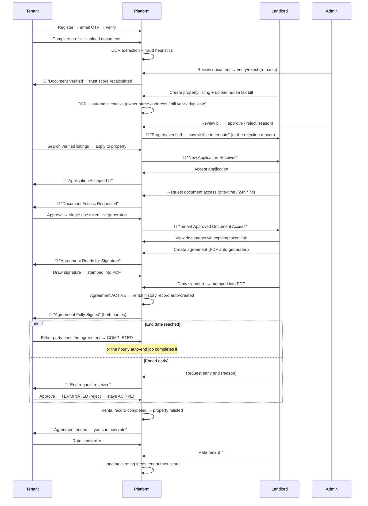

# VeriNest — Digital Tenant Verification Platform

> **Renting, without the leap of faith.**
> VeriNest verifies tenant documents **and landlord property ownership**, computes transparent
> trust scores, and handles digitally signed rental agreements — so tenants and landlords can
> trust each other before the keys change hands.

VeriNest is a full-stack web platform (M.Sc. IT Semester 3 minor project) that digitizes
the entire rental journey: tenants build a **verified profile once** (identity/income
documents checked through an OCR-assisted review pipeline) and share it with landlords
**on their own terms** through secure, expiring access links. Landlords prove they own the
property by uploading a **house tax bill** that an admin verifies before the listing goes
live, so tenants only ever see **verified listings**. Landlords see an **explainable trust
score** instead of a stack of unverifiable paperwork, and the whole flow — property
verification → application → verification → agreement signing → active tenancy → agreement
end → post-tenancy ratings — happens in one place.

---

## Table of contents

1. [Key features](#key-features)
2. [Tech stack](#tech-stack)
3. [Repository structure](#repository-structure)
4. [Architecture](#architecture)
5. [The rental lifecycle (how it all connects)](#the-rental-lifecycle)
6. [Core concepts](#core-concepts)
    - [Authentication & sessions](#1-authentication--sessions)
    - [Roles](#2-roles)
    - [Document verification pipeline](#3-document-verification-pipeline)
    - [Landlord property verification](#4-landlord-property-verification-house-tax-bill)
    - [Trust score](#5-trust-score)
    - [Secure document sharing](#6-secure-document-sharing-verification-requests)
    - [Rental agreements & digital signatures](#7-rental-agreements--digital-signatures)
    - [Agreement lifecycle: ending a tenancy](#8-agreement-lifecycle-ending-a-tenancy)
    - [Rental history & two-way ratings](#9-rental-history--two-way-ratings)
    - [Notifications & branded emails](#10-notifications--branded-emails)
    - [AI chat assistant](#11-ai-chat-assistant)
    - [Demo accounts](#12-demo-accounts)
7. [API reference](#api-reference)
8. [Data models](#data-models)
9. [Frontend](#frontend)
10. [Getting started](#getting-started)
11. [Testing](#testing)
12. [Security design](#security-design)
13. [Operational notes](#operational-notes)
14. [Known limitations](#known-limitations)

---

## Key features

**For tenants**
- Register with email OTP verification; build a detailed profile (addresses, employment, salary).
- Upload identity/income documents (Aadhaar, PAN, salary slips, …) — validated by magic-byte
  file signature checks, stored on Cloudinary, text-extracted with OCR, screened by fraud heuristics.
- A **transparent trust score** with human-readable reasons for every point awarded.
- Search & apply to property listings — only **admin-verified** listings are shown, each marked
  with a **Verified owner** badge on its detail page; track application status.
- Approve or decline landlord requests to view documents — access is consent-based and time-limited.
- Digitally sign rental agreements (canvas-drawn signature stamped into the PDF).
- **Agreements page**: see every agreement (active, end requests, ended); end an agreement
  after its end date, or request an early end that the landlord must approve.
- Rate landlords once a tenancy has ended.

**For landlords**
- Create and manage property listings with image galleries.
- **Prove ownership per property**: upload a house tax bill when adding a listing. An admin
  verifies it (OCR-assisted) before the listing becomes visible to tenants. See each listing's
  status (not submitted / pending / verified / rejected), read the rejection reason, and re-upload.
- Receive applications from tenants with verified profiles; accept/reject with one click.
- Request document access (one-time / 24-hour / 7-day windows) — granted only by tenant consent.
- Generate rental agreements (auto-built PDF) and sign digitally.
- **Agreements page**: end an agreement after its end date, request an early end (tenant
  approves), or approve/reject a tenant's early-end request.
- Rate tenants after the tenancy ends — landlord ratings feed the tenant's trust score.

**For admins**
- Review queue for uploaded documents (verify/reject with remarks).
- **Property verification queue**: see the uploaded tax bill next to what the landlord entered
  and what OCR read, with advisory auto-checks (owner name, address, bill year, duplicate tax
  ID, OCR confidence); approve, or reject with a reason the landlord sees.
- User directory with block/unblock/delete.
- Trigger trust-score recalculations; every change is logged with reasons.

**Platform-wide**
- In-app notification bell (30s polling) **and** branded HTML emails at every lifecycle event.
- Gemini-powered chat assistant that answers questions about *your own* account data only.
- Audit logging of sensitive actions (document decisions, property verification, verification access).
- Automatic completion of agreements that reach their end date (background job).
- Fully responsive UI with a consistent design system, site-wide header/footer shell,
  role-aware navigation, and public marketing pages.

---

## Tech stack

| Layer | Technology |
|---|---|
| Frontend | React 19, TypeScript, Vite, Tailwind CSS 3, Zustand (state), Axios, React Router 7 |
| Backend | Node.js, Express 5 (CommonJS), Mongoose 9 |
| Database | MongoDB |
| File storage | Cloudinary (documents, property images, house tax bills, agreement PDFs) |
| OCR | tesseract.js (local, no API key; tenant documents and house tax bills) + sharp (image preprocessing) |
| PDF generation | pdf-lib (agreement generation + signature stamping) |
| AI assistant | Google Gemini via `@google/genai` (`gemini-flash-lite-latest`) |
| Email | Nodemailer (SMTP) with branded inline-CSS HTML templates |
| Auth | JWT (access + refresh), bcryptjs, email OTP |
| Security | helmet, CORS allowlist, express-rate-limit, express-mongo-sanitize, express-validator |
| Testing | Jest, Supertest (unit + end-to-end smoke suite) |
| Linting | oxlint (frontend) |

---

## Repository structure

```
.
├── backend/                     # Express REST API (JavaScript, CommonJS)
│   ├── src/
│   │   ├── app.js               # Express app: security middleware, routes, error handler
│   │   ├── server.js            # Entry point: dotenv + DB connect + listen + hourly auto-end job
│   │   ├── config/              # db.js (Mongoose connect), cloudinary.js
│   │   ├── controllers/         # Route handlers (one per domain; propertyController,
│   │   │                        #   adminPropertyController, agreementLifecycleController,
│   │   │                        #   agreementRatingController, rentalHistoryController, …)
│   │   ├── cron/                # autoEndAgreements.js (completes agreements past their end date)
│   │   ├── emails/              # baseTemplate.js (branded HTML shell), templates.js (event templates)
│   │   ├── middlewares/         # auth (JWT), optionalAuth, role, upload (multer), taxBillUpload,
│   │   │                        #   property ownership, error handler
│   │   ├── models/              # Mongoose schemas (User, Document, Property, Agreement, RentalHistory, …)
│   │   ├── routes/              # API route definitions per domain (incl. adminPropertyRoutes)
│   │   ├── scripts/             # seedProperties.js (demo listings),
│   │   │                        #   migratePropertyVerification.js (one-off backfill)
│   │   ├── services/            # Business logic (trust score, OCR, fraud, PDF, email,
│   │   │                        #   propertyVerificationService, rentalRecordService, …)
│   │   └── utils/               # fileSignature.js (magic-byte validation)
│   └── tests/                   # smoke.e2e.test.js — full lifecycle E2E suite
└── frontend/                    # React SPA (TypeScript)
    └── src/
        ├── api/                 # Typed API modules (one per domain, types live beside their calls)
        │                        #   + shared axios client
        ├── components/          # Header, Footer, Layout, SignatureCapture, NotificationBell, ChatWidget,
        │                        #   PropertyVerificationPanel, AdminPropertyReviewModal, …
        ├── pages/               # Route pages (public, tenant, landlord, admin)
        ├── store/               # authStore.ts — auth state (zustand, persisted session)
        ├── utils/               # client-side file validation, propertyVerification (badges + auto-check chips)
        └── App.tsx              # Route tree: site-wide Layout → public + RequireAuth/RequireRole routes
```

---

## Architecture

### Backend — layered request flow

```
HTTP request
   │
   ▼
app.js  ── helmet → CORS allowlist → JSON parsing → mongo-sanitize → morgan (dev, token-redacting)
   │
   ▼
routes/      auth gate (authMiddleware) + role gate (roleMiddleware) + uploads (multer, memory)
   │
   ▼
controllers/ validate input → orchestrate → respond { data } or { error: "message" }
   │
   ▼
services/    business logic (trust score, OCR, fraud, PDF, tokens, email, notifications, audit,
             rental-record sync, property-verification auto-checks)
   │
   ▼
models/      Mongoose schemas → MongoDB
```

Design rules the codebase follows:

- **Side effects never break the primary action.** Notifications, emails, audit logs,
  trust-score recalculations, and rental-record creation/sync are all wrapped so a failure is
  logged but the API call still succeeds.
- **Errors have one shape**: `{ "error": "human-readable message" }` — the frontend's
  `getApiError()` relies on it.
- **Authorization is identity-based, never client-supplied.** Which agreement slot you
  sign, which side of a rental you're on, who may approve an end request, which direction
  a rating goes — all derived from the authenticated user id compared against the record.
- **Verification state is server-owned.** A property's `verification` block is stripped from
  every request body, so a landlord can't mark their own listing verified.
- `errorHandler` is the last middleware; `/api/health` is a dependency-free liveness check.

### Frontend — single shell, role-aware routing

Every route renders inside one `Layout` (sticky Header → page → Footer, plus the chat
widget when signed in). `RequireAuth` gates the app pages, `RequireRole` narrows
tenant/landlord/admin pages, and the header's nav links are computed from the logged-in
role — a tenant never sees "Received Applications", a landlord never sees "My Applications".

---

## The rental lifecycle

The complete happy path, end to end:



---

## Core concepts

### 1. Authentication & sessions

- **Registration** creates a `pending` account; a 6-digit **OTP** (10-minute expiry,
  bcrypt-hashed at rest) is emailed for verification. Only the latest OTP is valid.
- **Login** returns a **15-minute JWT access token** + **7-day refresh token**. Only a
  bcrypt hash of the refresh token is stored (`RefreshToken` collection, with a TTL index
  that auto-purges expired rows).
- **Sessions survive page reloads**: the user object and the 7-day refresh token are
  persisted to localStorage; the 15-minute access token stays memory-only and is
  silently re-minted on the first API call after a reload. Trade-off: the refresh
  token is exposed to XSS via storage (httpOnly-cookie refresh remains the hardening
  path); logout and password reset both revoke it server-side.
- The axios client attaches the Bearer token and, on a 401, performs **exactly one**
  silent refresh (via plain axios to avoid interceptor recursion) before redirecting to login.
- Rate limiting protects register, login, OTP send, chat, and token-access endpoints.
- A small `optionalAuth` middleware lets public routes (currently only `GET /properties/:id`)
  recognize a signed-in owner/admin without ever rejecting anonymous visitors.

### 2. Roles

| Role | Can do |
|---|---|
| `tenant` | Profile, documents, OCR/fraud checks, apply (to verified listings), respond to verification requests, sign, end/request-end agreements, rate landlord |
| `landlord` | Profile, listings + images, **upload a house tax bill per property**, decide applications, request verification, create/sign agreements, end/request-end agreements, rate tenant |
| `admin` | Document review queue, **property (tax bill) verification queue**, verify/reject with remarks, user management, trust-score recalculation |

Enforced server-side by `authMiddleware` (JWT) + `roleMiddleware`; mirrored client-side
by `RequireRole` (UX only — the API is the real gate).

### 3. Document verification pipeline

```
upload (multer, in-memory)
  → magic-byte signature check (utils/fileSignature.js — extension/mimetype are never trusted)
  → Cloudinary upload (per-type folders)
  → OCR (tesseract.js + sharp preprocessing) → extracted fields stored on the Document
  → fraud heuristics (fraudDetectionService) → risk signals
  → admin review (verify / reject + remarks)
  → verified docs feed the trust score; tenant notified by email either way
```

`extractedData` and internal metadata are **never** exposed through the public
document-sharing endpoint — only document type, file URL, and verification status.

### 4. Landlord property verification (house tax bill)

Tenants are verified through documents; landlords are verified **through their properties**.
Each listing needs its own house tax bill, checked by an admin, before tenants can see it.
Verification is per property (one landlord, many properties, many bills).

**Status lifecycle**

```
not_submitted ──(upload bill)──► pending ──(admin approves)──► verified
                                    │  ▲                          │
                          (rejects) ▼  │ (re-upload)              │ (address edited)
                                 rejected                         ▼
                                                  pending / not_submitted (re-verification)
```

| Status | Meaning | Visible to tenants? |
|---|---|---|
| `not_submitted` | Listing created, no bill yet (default) | No |
| `pending` | Bill uploaded, waiting for an admin | No |
| `verified` | Admin approved the bill | **Yes** (if also `available`) |
| `rejected` | Admin rejected it with a reason the landlord sees; re-upload allowed | No |

**Landlord flow**

1. **Add property** — the form requires a house tax bill (JPG/PNG, max 4 MB client-side /
   5 MB server-side). The app creates the listing, then uploads the bill; the listing starts as
   `pending`. If the bill upload fails, the listing still exists (hidden) and the property card
   offers **Upload tax bill** to retry.
2. **Upload pipeline** — magic-byte file check → Cloudinary → OCR (tesseract.js; English by
   default, `TAX_BILL_OCR_LANG=eng+guj` for Gujarati bills) → field extraction (owner name,
   property tax ID, bill year, amount) → advisory auto-checks → `pending`. OCR is best effort:
   a failed or empty scan never blocks the submission; the admin reviews the image either way.
3. **Track & fix** — each card shows a status badge; a rejected listing shows the admin's reason
   and an **Upload new bill** button. A pending bill can be replaced. A property can be
   submitted at most **5 times**; after a verified decision no more uploads are accepted.
4. **Editing a verified listing's address** sends it back to review (it needs a bill that matches
   the new address) and hides it from tenants until re-approved.

**Admin flow** (`/admin/properties`, "Property Review")

- Tabs for **pending / verified / rejected** with live counts; the pending queue is oldest-first.
- The review modal shows the **bill image**, what the landlord entered vs. what OCR read, the OCR
  confidence and raw text, and **advisory chips**:

  | Check | How it works |
    |---|---|
  | Owner name match | % of the landlord's name tokens found anywhere in the OCR text (order-insensitive) |
  | Address match | % of the entered address/city/pincode tokens found in the OCR text |
  | Bill year | Accepts the current or previous Indian financial year (April start) |
  | Duplicate bill | Same property tax ID already on another property |
  | Low OCR confidence | Confidence below 40% or no readable text |

  Chips are **advisory only** — nothing is auto-approved or auto-rejected; OCR can misread.
- **Approve**, or **Reject** with a required reason (≥ 3 characters). The decision is atomic and
  only valid for a `pending` property, so two admins can't both decide it (the second gets 409).
  The landlord gets an in-app notification and the action is audit-logged.

**What tenants see**

- Search (`GET /properties`) returns only `available` **and** `verified` listings, and strips the
  bill, OCR text, auto-checks and review details from every result.
- A direct link to an unverified listing returns **404** for everyone except its owner and admins
  (the owner/admin sees a "not verified yet" notice). Verified listings show a **Verified owner**
  badge, and the Apply button is hidden for anything unverified.

**Existing listings.** Listings created before this feature have no verification data. Run
`npm run migrate:property-verification` once: by default it **grandfathers** them as verified;
pass `-- --pending` to force every existing listing through review instead.

### 5. Trust score

`computeTrustScore` (`backend/src/services/trustScoreService.js`) is a **pure,
deterministic function** — no DB access, fully unit-tested — so every score is
reproducible and explainable. Rules:

| Rule | Points |
|---|---|
| Each distinct verified document type (capped at 3 types) | +15 each (max +45) |
| Police verification completed | +15 |
| Both current & permanent addresses complete | +10 |
| Employment salary information provided | +10 |
| Avg landlord rating above 3★ (+2 per full star, from rental history) | up to +10 |

Every recalculation writes a `TrustScoreHistory` entry with the plain-language reasons
that contributed (e.g. *"Verified aadhaar document (+15)"*). Recalculation triggers:
admin verifies a document, a landlord rates the tenant, or an admin forces one.
(Property verification is separate and does not affect the tenant trust score.)

### 6. Secure document sharing (verification requests)

The most security-sensitive flow, designed so raw document access is **consent-based,
time-boxed, and unforgeable**:

1. Landlord requests access on an **accepted** application, choosing `one_time`,
   `24_hours`, or `7_days`. If every document is already admin-verified the request is
   refused (409) — there's nothing left to verify. Creating a request **re-queues any
   rejected documents** (`rejected` → `pending`) for a fresh admin review.
2. Tenant approves (or rejects). On approval the server generates a **256-bit random
   token**; only its **SHA-256 hash** is persisted. The raw token appears exactly once —
   in the approval response shown to the tenant, who shares the link.
3. Anyone with the link hits the **public** endpoint `GET /api/verification/access/:token`.
   One-time links are claimed **atomically** (two concurrent requests can't both win);
   expired/used links return generic errors that reveal nothing.
4. Every successful access is **audit-logged**. Request logs **redact** the token, and
   notification emails never contain it — they tell the landlord to check the platform.

### 7. Rental agreements & digital signatures

- Landlord creates an agreement from an accepted application → a **PDF is generated**
  (pdf-lib) with the terms, parties, and signature boxes, and uploaded to Cloudinary.
- Each party sees **only their own signature slot** in the UI and draws a signature on a
  canvas (`SignatureCapture` — blank signatures are rejected client-side; server-side the
  image must be a real PNG/JPEG under 1 MB by magic-byte check).
- Which slot you sign is decided by **identity match only** — the backend compares your
  user id to the agreement's `tenantId`/`landlordId`; a role claim can't forge it.
  Double-signing returns 409.
- When the second signature lands, the agreement flips to **active**, `signedAt` is
  stamped, a **rental history record is auto-created**, and both parties get the "fully
  signed" email. The property is marked **occupied** — it disappears from public search
  and stops accepting applications until the tenancy ends.
- Agreement duration must be **3–11 months**; an agreement can't be created for a
  property that is currently occupied.

### 8. Agreement lifecycle: ending a tenancy

An agreement moves through these statuses:

```
draft ──(both sign)──► active ──(early end requested)──► end_requested
                          │                                  │   │
                          │ (end date reached)       approve │   │ reject / cancel
                          ▼                                  ▼   ▼
                      completed                        terminated  back to active
```

| Status | Meaning |
|---|---|
| `draft` | Created, waiting for signatures |
| `active` | Both parties signed — the tenancy is running |
| `end_requested` | One party asked to end early; the other party must respond |
| `completed` | Ended on/after the end date (`endType: natural`) |
| `terminated` | Ended before the end date with the other party's approval (`endType: early_approved`) |

**Rules (all enforced by the API, identity-based)**

| Situation | What happens |
|---|---|
| Either party ends **on/after the end date** | Completes immediately — no approval needed |
| Either party ends **before the end date** | Must give a reason (≥ 5 characters); creates an end request and emails the other party |
| Other party **approves** | Agreement becomes `terminated` |
| Other party **rejects** | Agreement returns to `active` |
| Requester **cancels** | Agreement returns to `active` |
| Requester tries to approve their own request | Refused — only the other side can respond |
| Second request while one is pending | Refused (409) |
| End date passes and nobody acts | Hourly auto-end job completes the agreement |

**The Agreements page** (`ActiveAgreementsPage`, shared by tenant and landlord) has three tabs —
*Active*, *End requests*, *Ended*. `GET /api/agreements/mine/lifecycle` returns each agreement
with the caller's role, the counterparty, and ready-made action flags (`canInitiateEnd`,
`isEarlyEnd`, `canRespondEndRequest`, `canCancelEndRequest`, `canRate`, `iRated`, `myRating`)
so the UI never re-implements the rules. On an ended agreement the page shows either a
**Rate tenant / Rate landlord** button (opens a rating popup on the same page) or
**Already rated ★★★★★** once the caller has rated.

**What happens when an agreement ends** (natural end, approved early end, or the auto-end job):

1. The `RentalHistory` record is created if missing and gets its `moveOutDate`
   (`services/rentalRecordService.js`, idempotent).
2. The property flips `occupied → available` — unless another open agreement still holds it.
3. Any pending end request is closed.
4. Both parties receive an "agreement ended — you can now rate" notification/email.

**Auto-end job** (`cron/autoEndAgreements.js`): started from `server.js` once MongoDB is
connected, runs immediately and then hourly. Each agreement is claimed with an atomic
`findOneAndUpdate`, so a user ending it at the same moment can't double-process it. It uses a
plain `setInterval`, so it runs only on a long-lived server — not on Vercel serverless (the
manual end button still works there).

### 9. Rental history & two-way ratings

- A record is created when an agreement activates (unique per agreement — no duplicates).
  The same idempotent sync also **self-heals**: it runs when an agreement ends, when a rating
  is submitted, and when `GET /rental-history/mine` loads, so an agreement can never be left
  without its record.
- A rental is **completed** when its agreement ends (`moveOutDate` is set). The landlord can
  also use *Mark as completed* on the Rental history page — but only once the agreement has
  reached its end date (409 before that; early endings must go through the Agreements page so
  the tenant's approval can't be bypassed).
- **Rating direction is fixed by identity**: tenants rate landlords, landlords rate
  tenants — the UI doesn't even offer a choice, and the API derives the direction from
  who is calling. One rating per side (duplicates return 409); ratings open only after the
  rental has ended; the rated party is notified by email.
- Ratings are **embedded in the `RentalHistory` record** (`tenantRating` = what the landlord
  said about the tenant; `landlordRating` = what the tenant said about the landlord).
- Two entry points write the same data: `POST /api/agreements/:id/rate` (used by the
  Agreements page popup — it creates/completes the record on demand) and
  `PATCH /api/rental-history/:id/rate` (used by the Rental history page, which also accepts a
  `?rate=<agreementId>` deep link). Only **landlord→tenant** ratings affect the tenant's
  trust score.

### 10. Notifications & branded emails

Two delivery channels, one source of truth:

- `createNotification()` always writes a `Notification` record (powers the header bell,
  which polls every 30 s with optimistic mark-as-read).
- For `type: "email"` it additionally sends through `emailService`. **Branded HTML
  templates** (`backend/src/emails/templates.js`) cover the lifecycle: application
  submitted/accepted/rejected, document verified/rejected, verification request
  received/approved, agreement created/fully signed, **agreement end requested /
  agreement ended**, rating received. All share one inline-CSS shell (email clients strip
  `<style>` blocks), include plain-text fallbacks, escape all user-supplied values, and
  **never carry sensitive payloads** — CTAs link back to the app via `FRONTEND_URL`.
- Property verification decisions currently notify the landlord **in-app only** (no email template yet).
- Plain-text callers (like the OTP email) are automatically wrapped in the branded shell.
- **Dev behavior**: if SMTP isn't configured (or sending fails outside production), the
  email is logged to the backend console as `[DEV EMAIL]` instead of throwing — flows
  never block on mail. In production, missing SMTP config is a hard error.

### 11. AI chat assistant

A floating chat widget (authenticated users only) backed by Gemini. The backend builds a
JSON context containing **only the caller's own data** (profile, documents, applications,
trust score, …) and instructs the model to answer solely from it — questions about other
users are refused by design. Rate-limited per user; 503/429 states are surfaced
gracefully in the UI.

### 12. Demo accounts

Two fixed guest logins — **demo tenant** and **demo landlord** — let anyone explore the
platform without signing up. They are ordinary accounts (`isDemo: true`), so every feature
genuinely works: uploads, applications, agreements, the chat assistant. What keeps them
safe is the reset: **on every demo sign-in the backend wipes and rebuilds their entire
workspace** from one curated snapshot (`services/demoService.js`) — profiles, 3 listings,
2 documents, 2 applications, a pending verification request, notifications and a real
trust-score pass. Whatever the previous visitor did is gone.

- Credentials are served publicly by `GET /api/auth/demo-accounts`. When they exist the login
  page becomes two columns — demo accounts on the left, the normal login form on the right
  (stacked with the form first on phones); when they don't, it stays the plain single card
  (same graceful-degradation pattern as the Google button).
- Choosing an account **autofills the real login form** and submits it, so it's obvious which
  credentials were used and they stay on screen if anything fails.
- While signed in as a demo user the app shows a standing **demo-mode banner**.
- The demo landlord's seeded listings are **hidden from the public property search**
  (`GET /api/properties`) so throwaway fixtures never pollute the real market. They still
  appear under the landlord's own `/properties/mine`. Because unverified listings now return
  404 on `GET /properties/:id` for everyone but the owner/admin, the demo listings must be
  seeded already verified for the seeded applications to link to a working detail page
  (see [Known limitations](#known-limitations)).
- Two people demoing at once share one workspace; the second sign-in resets the first one's
  data mid-session. That's the accepted trade-off — nothing real may ever live here.
- Create/rebuild them with `npm run seed:demo`; override the passwords with
  `DEMO_TENANT_PASSWORD` / `DEMO_LANDLORD_PASSWORD`. Demo accounts are always
  `tenant`/`landlord` — never `admin`.

---

## API reference

Base URL: `http://localhost:5000/api` · All responses: `{ ...data }` or `{ "error": "message" }`
Auth = `Authorization: Bearer <accessToken>` unless marked *public*.

### Health
| Method | Path | Access | Purpose |
|---|---|---|---|
| GET | `/health` | public | Liveness check |

### Auth & OTP
| Method | Path | Access | Purpose |
|---|---|---|---|
| POST | `/auth/register` | public (rate-limited) | Create account (pending until OTP verified) |
| POST | `/auth/otp/send` | public (rate-limited) | Send OTP (`signup`, `forgot_password`, `email_verification`, `login`) |
| POST | `/auth/otp/verify` | public | Verify OTP → activates account; for `signup` also returns access + refresh tokens (auto-login) |
| POST | `/auth/login` | public (rate-limited) | Login → access + refresh tokens |
| POST | `/auth/google` | public (rate-limited) | Verify Google ID token server-side → login/signup → access + refresh tokens |
| PATCH | `/auth/set-role` | any authed | One-time role pick (`tenant`/`landlord`) for a new Google account (only while role is unset) |
| POST | `/auth/refresh` | public | Exchange refresh token for new access token |
| POST | `/auth/logout` | public | Revoke refresh token |
| GET | `/auth/me` | any authed | Current token payload (id, role) |
| GET | `/auth/demo-accounts` | public | Guest demo credentials for the login page (empty list until seeded) |

### Profiles
| Method | Path | Access | Purpose |
|---|---|---|---|
| POST / GET / PUT | `/tenant-profile` · `/tenant-profile/me` | tenant | Create / read / update own profile |
| POST / GET / PUT | `/landlord-profile` · `/landlord-profile/me` | landlord | Create / read / update own profile |

### Documents
| Method | Path | Access | Purpose |
|---|---|---|---|
| POST | `/documents/upload` | tenant | Upload a document (multipart `file`) |
| GET | `/documents/my` | tenant | List own documents |
| POST | `/documents/:id/ocr` | tenant | Run OCR extraction |
| POST | `/documents/:id/fraud-check` | tenant/admin | Run fraud heuristics |
| GET | `/admin/documents?status=` | admin | Review queue (pending/verified/rejected) |
| GET | `/admin/documents/users` | admin | Users with documents + per-status counts |
| GET | `/admin/documents/users/:tenantId` | admin | All documents of one user |
| PATCH | `/admin/documents/:id` | admin | Verify or reject (+ remarks) |

### Admin — user management
| Method | Path | Access | Purpose |
|---|---|---|---|
| GET | `/admin/users?search=&role=&status=&page=&limit=` | admin | User directory (tenants, landlords, admins; name/email/phone search) |
| GET | `/admin/users/:id` | admin | One account with its profile and activity counts |
| PATCH | `/admin/users/:id/status` | admin | Block / reactivate (`{ status: "active"\|"blocked", reason? }`) |
| DELETE | `/admin/users/:id` | admin | Delete the account and every record it owns |

Blocking sets `accountStatus: "blocked"` (rejected by every sign-in path) and deletes
the user's refresh tokens, so live sessions end within the access token's 15-minute
lifetime. Deletion is refused (409) while the user is party to an active agreement,
and an admin can neither block nor delete themselves or another admin.

### Properties
| Method | Path | Access | Purpose |
|---|---|---|---|
| GET | `/properties` | public | Search (city, rent range, bedrooms, furnishing, type; paginated). Returns only `available` **and** admin-`verified` listings; bill/OCR/review details are never included |
| GET | `/properties/:id` | public* | Listing detail. *Unverified listings return 404 unless the caller is the owner or an admin (send a Bearer token). Response is trimmed per viewer (public / owner / admin) |
| POST | `/properties` | landlord | Create listing (starts `verification.status: "not_submitted"`; any `verification` key in the body is ignored) |
| GET | `/properties/mine` | landlord | Own listings, all statuses, with verification status, bill link and rejection reason |
| PUT | `/properties/:id` | owner | Update listing. Changing the address of a verified listing sends it back to review (`reverification: true` in the response) |
| DELETE | `/properties/:id` | owner | Soft-delete (marks the listing `inactive`) |
| POST | `/properties/:id/images` | owner | Upload up to 10 images (multipart `images`) |
| POST | `/properties/:id/tax-bill` | owner | Upload/replace the house tax bill (multipart `taxBill`, JPG/PNG ≤ 5 MB). Runs OCR + auto-checks, sets status `pending`. 409 if already verified; 403 after 5 submissions |

### Admin — property verification
| Method | Path | Access | Purpose |
|---|---|---|---|
| GET | `/admin/properties?status=pending\|verified\|rejected&page=&limit=` | admin | Review queue with full verification data (bill URL, OCR fields, auto-checks), the populated landlord, and per-status `counts` |
| PATCH | `/admin/properties/:id` | admin | `{ status: "verified" \| "rejected", remarks? }` — `remarks` (≥ 3 chars) required to reject. Only valid while `pending` (409 otherwise); atomic, so concurrent admins can't both decide. Notifies the landlord in-app and writes an audit log |

### Applications
| Method | Path | Access | Purpose |
|---|---|---|---|
| POST | `/applications` | tenant | Apply (requires complete profile; no duplicates) |
| GET | `/applications/:id/tenant-profile` | landlord | Screening summary: trust score, safe profile fields, document statuses |
| GET | `/applications/mine` | tenant | Own applications |
| GET | `/applications/received` | landlord | Incoming applications |
| PATCH | `/applications/:id` | landlord | Accept / reject |

### Verification requests & token access
| Method | Path | Access | Purpose |
|---|---|---|---|
| POST | `/verification-requests` | landlord | Request document access (accepted applications only) |
| GET | `/verification-requests/mine` | tenant | Incoming requests |
| PATCH | `/verification-requests/:id/respond` | tenant | Approve (→ one-time raw token) / reject |
| GET | `/verification/access/:token` | public (rate-limited) | View shared documents via token |

### Agreements
| Method | Path | Access | Purpose |
|---|---|---|---|
| POST | `/agreements` | landlord | Create agreement + generate PDF |
| GET | `/agreements/mine` | party | Own agreements (raw documents) |
| GET | `/agreements/mine/lifecycle` | party | Own agreements enriched for the Agreements page: caller's role, counterparty, rated state, and action flags |
| GET | `/agreements/:id` | party/admin | Agreement detail |
| PATCH | `/agreements/:id/sign` | party | Sign own slot (base64 signature image) |
| PATCH | `/agreements/:id/end` | party | `{ reason? }` — on/after end date: completes immediately; before it: creates an end request (reason ≥ 5 chars required) |
| PATCH | `/agreements/:id/end/respond` | party (the *other* side) | `{ action: "approve" \| "reject", note? }` — approve → `terminated`, reject → back to `active` |
| PATCH | `/agreements/:id/cancel-end-request` | requester | Withdraw own pending request → back to `active` |
| POST | `/agreements/:id/rate` | party | `{ rating: 1–5, review? }` — rate the other side once the agreement has ended |

Route order matters: `/mine` and `/mine/lifecycle` must be registered **before** `/:id` (the same applies to `/properties/mine`).

### Rental history, notifications, trust score, chat
| Method | Path | Access | Purpose |
|---|---|---|---|
| GET | `/rental-history/mine` | party | Own rental records (creates any missing record for an active/ended agreement first) |
| PATCH | `/rental-history/:id/complete` | landlord (party) | Set move-out date; closes the agreement and relists the property. Refused (409) before the agreement's end date |
| PATCH | `/rental-history/:id/rate` | party | Rate the other side (1–5 + review); only after the rental has ended; 409 on duplicate |
| GET | `/notifications/mine` | any authed | Own notifications + unread count |
| PATCH | `/notifications/:id/read` | any authed | Mark as read |
| POST | `/trust-score/recalculate/:tenantId` | admin | Force recalculation |
| POST | `/chat` | any authed (rate-limited) | Ask the AI assistant |

---

## Data models

| Model | Purpose / notable fields |
|---|---|
| `User` | fullName, email, phone, bcrypt password, role, OTP fields, accountStatus, `isDemo`, `ratingAvg`/`ratingCount`; sensitive fields are `select: false` and stripped from JSON |
| `RefreshToken` | bcrypt hash of refresh JWT, TTL index auto-expiry |
| `TenantProfile` / `LandlordProfile` | addresses, employment/salary, police verification status, etc. |
| `Document` | type, Cloudinary ref, verificationStatus, OCR `extractedData`, remarks, verifiedBy/At |
| `Property` | title, address, rent, bedrooms, furnishing, type, images, status (`available`/`occupied`/`inactive`), landlordId, and a server-owned **`verification`** block: `status` (`not_submitted`/`pending`/`verified`/`rejected`), `grandfathered`, `taxBill` (Cloudinary ref + uploadedAt), `ocr` (status, rawText, confidence, extracted owner name / property tax ID / bill year / amount), `autoChecks` (ownerNameMatch, addressMatch, billYearValid, duplicateBill, lowOcrConfidence), `attempts`, `reviewedBy`/`reviewedAt`, `rejectionReason` |
| `Application` | tenant ↔ property ↔ landlord, status (pending/accepted/rejected/cancelled), message |
| `VerificationRequest` | accessType, status, SHA-256 `secureToken` (select:false), expiresAt, viewedAt |
| `Agreement` | parties, applicationId, unique agreementNumber, dates, rent/deposit, PDF ref, `tenantSigned`/`landlordSigned` (+ signed-at times), `signedAt` (activation), `status` (`draft`→`active`⇄`end_requested`→`completed`/`terminated`), `endRequests[]` (requestedBy, requestedByRole, reason, status `pending`/`approved`/`rejected`/`cancelled`, respondedAt, responseNote), `endedAt`, `endType` (`natural`/`early_approved`), `tenantRated`/`landlordRated` flags |
| `RentalHistory` | unique per agreement (`agreementId`); move-in/out, rent, deposit, `tenantRating`/`landlordRating` + reviews, paymentStatus. Ratings live here, not in a separate collection |
| `Notification` | receiver, title/message, type (push/email), event, isRead |
| `TrustScoreHistory` | tenant, score, reasons[], generatedBy |
| `AuditLog` | user, action, module, request metadata |

---

## Frontend

**Design system** (`tailwind.config.js`): `primary` (indigo) + `success`/`warning`/`danger`/`info`
semantic scales, slate as the neutral scale, shared font stack (matching the email
templates), `shadow-card` elevation, documented radius conventions.

**Pages**

| Area | Routes |
|---|---|
| Public | `/` (landing), `/properties`, `/properties/:id` (verified owner badge), `/about`, `/services`, `/contact`, `/privacy`, `/terms`, `/login`, `/register`, `/verify-otp`, `/verify/:token` (share-link viewer) |
| Tenant | `/dashboard`, `/profile`, `/documents`, `/my-applications`, `/verification-requests`, `/rental-history`, `/agreements/:id` (view & sign), `/agreements` (Agreements page: active / end requests / ended + ratings) |
| Landlord | `/dashboard`, `/profile`, `/my-properties` (listings + tax-bill upload and verification status), `/received-applications`, `/rental-history`, `/agreements/:id` (view & sign), `/agreements` (Agreements page) |
| Admin | `/admin` (document review), `/admin/properties` (property verification), `/admin/users`, `/admin/trust-score` |

Notable components: `Header` (role-aware nav, user menu, mobile hamburger), `Footer`,
`SignatureCapture` (canvas pad with blank-signature guard), `NotificationBell` (polling +
optimistic reads), `ChatWidget`, `VerificationRequestModal`. `PropertyVerificationPanel`
(under each landlord property card: status badge, rejection reason, bill link, upload/replace)
and `AdminPropertyReviewModal` (bill image, entered-vs-OCR comparison, advisory chips,
approve / reject-with-reason) back the property verification flow. `ActiveAgreementsPage`
carries its own end-agreement and rating popups; `RentalHistoryPage` shows both parties'
ratings and handles the `?rate=<agreementId>` deep link. API types live next to their calls in
`src/api/` (there is no separate `types/` folder).

---

## Getting started

### Prerequisites

- **Node.js ≥ 18** (includes npm)
- **MongoDB** — local Community Server or an Atlas cluster
- Optional but recommended for full functionality: **Cloudinary** account (file storage),
  **Gmail app password** or any SMTP (emails), **Gemini API key** (chat assistant)

### 1. Install

```bash
cd backend  && npm install
cd ../frontend && npm install
```

### 2. Configure environment

```bash
# from the repo root (use `copy` on Windows cmd)
cp backend/.env.example backend/.env
cp frontend/.env.example frontend/.env
```

**backend/.env**

| Variable | Required | Purpose |
|---|---|---|
| `PORT` | no (5000) | API port |
| `MONGO_URI` | **yes** | e.g. `mongodb://localhost:27017/tenant-verification` |
| `JWT_SECRET` / `JWT_REFRESH_SECRET` | **yes** | Sign access / refresh tokens — use long random strings |
| `ALLOWED_ORIGINS` | no | CORS allowlist, comma-separated (default `http://localhost:5173`) |
| `FRONTEND_URL` | no | Base URL for links inside emails (default `http://localhost:5173`) |
| `EMAIL_SMTP_HOST/PORT/USER/PASS` | for real email | e.g. `smtp.gmail.com` + app password; without it, emails print to the console |
| `CLOUDINARY_CLOUD_NAME/API_KEY/API_SECRET` | for uploads | Documents, images, house tax bills, agreement PDFs |
| `GEMINI_API_KEY` | for chat | AI assistant (`GEMINI_MODEL` optional override) |
| `TAX_BILL_OCR_LANG` | no (`eng`) | Tesseract language(s) for house tax bills, e.g. `eng+guj` for Gujarati bills (slower; downloads language data on first use) |
| `HF_API_KEY` | reserved | Not currently required |

**frontend/.env** — just `VITE_API_BASE_URL=http://localhost:5000/api`.

> ⚠️ Never commit `.env` files — they're gitignored; only `.env.example` belongs in the repo.

### 3. Run

```bash
# Terminal 1 — backend on http://localhost:5000
cd backend && npm run dev

# Terminal 2 — frontend on http://localhost:5173
cd frontend && npm run dev
```

Sanity checks: `curl http://localhost:5000/api/health` → `{"status":"ok"}`, then open
http://localhost:5173. The backend also starts the hourly auto-end job once MongoDB connects
(you'll see `[cron] Auto-completed N agreement(s)` when it ends something).

### 4. Backfill existing properties (once, if you already have listings)

Listings created before property verification have no `verification` data and stay hidden from
tenants until they're migrated:

```bash
cd backend
npm run migrate:property-verification              # grandfather existing listings as verified
npm run migrate:property-verification -- --pending # or force them through review
```

### 5. Optional: seed demo properties

```bash
cd backend && npm run seed:properties
```

Seeded listings are created unverified; run the migration above afterwards (or mark them verified
in the seed script) to make them visible to tenants. See [Known limitations](#known-limitations).

### 6. Optional: seed the guest demo accounts

```bash
cd backend && npm run seed:demo
```

This creates (or rebuilds) two public guest logins — a tenant and a landlord — and prints
their credentials. Once they exist, the login page grows a **"Try VeriNest with a demo
account"** panel that signs a visitor in with one click, so the project can be explored
without registering. See [Demo accounts](#12-demo-accounts).

### 7. Try the full flow

Register a tenant (the OTP arrives by email, or in the backend console when SMTP is
unconfigured), complete the profile, upload a document. Register a landlord, add a property
**with a house tax bill** (a clear JPG/PNG whose labels read like "Name of Owner:", "Property
Tax No:", "Financial Year:", "Amount Payable:" OCRs best). Promote a user to `admin`/`landlord`
directly in MongoDB if needed (registration deliberately has no role selection):

```js
// mongosh
use tenant-verification
db.users.updateOne({ email: "you@example.com" }, { $set: { role: "admin" } })
```

Then, as admin, open **Property Review**, check the advisory chips against the bill image, and
approve — the listing appears in tenant search with a *Verified owner* badge. Try rejecting
another one with a reason and re-uploading as the landlord.

To try the **end-of-tenancy flow** quickly, sign an agreement from both accounts, then open the
Agreements page: ending before the end date sends a request the other side must approve; to
test the natural end without waiting, move the agreement's `endDate` into the past in MongoDB
(the end button — or the hourly job — then completes it and unlocks ratings).

---

## Testing

```bash
cd backend
npm test              # unit tests (trust score rules, property-verification auto-checks) — no DB needed
npm run test:smoke    # full E2E lifecycle — requires local MongoDB

npx jest tests/demoLogin.e2e.test.js --runInBand   # guest demo accounts + reset-on-login
```

The **smoke suite** (`backend/tests/smoke.e2e.test.js`) chains the entire journey —
register → OTP → profile → property → document upload → OCR → admin approval → trust
score → application → verification request → token access — against a **dedicated
throwaway database** (`tenant-verification-smoke-test`, dropped before/after) with email
mocked. It's the go-to regression check after cross-cutting changes. It does **not** yet
cover the agreement end/rating lifecycle or property verification, and because new properties
now start hidden from tenants it needs updating (upload a bill, approve it as admin) before it
passes end to end again. The property-verification flow is verified manually (see
[Try the full flow](#7-try-the-full-flow)); its pure auto-check helpers are unit-tested in
`src/services/__tests__/propertyVerificationService.test.js`.

Frontend: `npm run build` (type-check + bundle) and `npm run lint` (oxlint). There are no
frontend unit tests; UI flows are verified manually / via browser automation.

---

## Security design

- **Passwords & OTPs** bcrypt-hashed; refresh tokens stored only as bcrypt hashes with TTL cleanup.
- **Access tokens 15 min**, refresh 7 days, one-shot silent refresh on the client.
- **Access tokens never touch browser storage** (memory-only); the refresh token persists
  in localStorage for reload-surviving sessions and is revocable server-side.
- **Document share links**: 256-bit entropy, SHA-256 hash at rest, single-use claimed atomically,
  redacted from logs, never emailed.
- **NoSQL-injection defense**: inbound `$`/`.` keys stripped in place (Express 5-compatible
  mongo-sanitize usage); strict string-type checks on credential fields.
- **Uploads**: in-memory multer + magic-byte validation — extensions and mimetypes are never
  trusted (documents, property images and house tax bills alike).
- **helmet** defaults (CSP, HSTS, …), explicit **CORS allowlist**, **rate limits** on auth/OTP/chat/token-access.
- **Least disclosure**: generic 404/410 responses on token access; OCR data never exposed
  via share links; email bodies carry no sensitive payloads.
- **Property verification integrity**: the `verification` block can't be written from any request
  body (stripped, including dotted paths), so landlords can't self-verify; admin decisions are
  atomic and only valid from `pending`; unverified listings are 404 for everyone but the owner
  and admins; tenant-facing responses never include the tax bill URL, OCR text, auto-checks or
  review details.
- **Agreement integrity**: end/approve/cancel/rate permissions are derived from the caller's
  user id against the agreement, never from client input; an early end can't happen without the
  other party's approval (the Rental history *Mark as completed* shortcut is blocked before the
  end date for the same reason).
- **Auditability**: document decisions, property verification uploads/decisions and share-link
  accesses land in `AuditLog`; trust-score changes keep their reasons in `TrustScoreHistory`.

---

## Operational notes

- **Stale MongoDB indexes.** Mongoose never drops indexes when a schema changes. If a field was
  renamed in the past, an old *unique* index can linger and make new inserts fail with
  `E11000 duplicate key … dup key: { <oldField>: null }`. Compare `db.<collection>.getIndexes()`
  with the model and drop the extras (e.g. `db.rentalhistories.dropIndex('agreement_1')`).
  `RentalHistory` should only have `_id_`, `tenantId_1`, `landlordId_1`, `agreementId_1` (unique).
- **Auto-end job on serverless.** `setInterval` doesn't run on Vercel serverless. There, completion
  happens when a user presses *End agreement* (allowed after the end date) or via a scheduled
  call you add yourself.
- **Data from the old end flow.** Agreements saved before the lifecycle feature may carry the old
  status `ended`, old `signatures` / `activatedAt` fields, or end requests in the old
  `requester`/`target` shape; migrate or clear them before relying on the new flow.
- **Properties from before property verification.** They have no `verification` field and are
  invisible to tenants until `npm run migrate:property-verification` runs (grandfather by default,
  `-- --pending` to force review). Re-running it is safe — it only touches documents without a status.
- **Tax-bill OCR.** Only JPG/PNG bills are accepted (tesseract.js can't read PDFs). OCR is English-only
  unless `TAX_BILL_OCR_LANG` is set (e.g. `eng+guj`). Bills are scanned inside the upload request, so a
  submission can take several seconds; OCR failures never block a submission.

---

## Known limitations

These are deliberate follow-ups, not hidden behavior:

- **Applications aren't gated server-side yet.** Only the UI hides *Apply* for unverified listings;
  the apply endpoint should also reject properties whose verification status isn't `verified`.
- **Seeds, demo accounts and the smoke test predate property verification.** They create properties
  that start unverified (hidden from tenants), so seeded/demo listings must be marked verified and the
  smoke test needs a bill-upload + admin-approval step.
- **Tax bills use a public Cloudinary URL.** It is removed from every response except the owner's and
  admins', but the asset itself isn't access-restricted; authenticated/private delivery is a
  `cloudinaryService` change.
- **No verified badge on search cards** (it appears on the listing detail page), and property verification
  decisions send an in-app notification but no email.
- **Tax-bill matching is heuristic.** OCR layouts differ per municipality and the auto-checks are advisory;
  an admin always makes the final call against the image.

---

## Scripts reference

| Where | Command | What it does |
|---|---|---|
| backend | `npm run dev` | API with nodemon (auto-restart) |
| backend | `npm start` | API with plain node |
| backend | `npm test` | Jest unit tests under `src/` |
| backend | `npm run test:smoke` | End-to-end lifecycle suite (needs local MongoDB) |
| backend | `npm run seed:properties` | Insert demo property listings |
| backend | `npm run seed:demo` | Create/reset the public guest demo accounts and print their credentials |
| backend | `npm run migrate:property-verification` | Backfill `verification` on pre-existing properties (grandfathered as verified; add `-- --pending` to force review) |
| frontend | `npm run dev` | Vite dev server (HMR) |
| frontend | `npm run build` | Type-check (`tsc -b`) + production bundle |
| frontend | `npm run preview` | Serve the production build locally |
| frontend | `npm run lint` | oxlint |

---

## About

VeriNest is developed as a **Minor Project for M.Sc. IT (Semester 3)**. It is an academic
project: the legal pages are illustrative, and the platform is not (yet) a production
service. Questions and feedback are welcome via the in-app contact page.