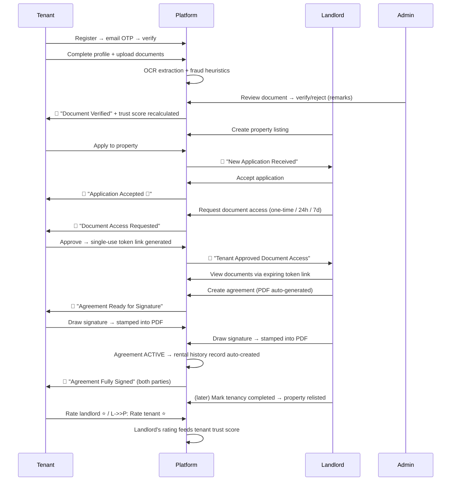

# VeriNest — Digital Tenant Verification Platform

> **Renting, without the leap of faith.**
> VeriNest verifies tenant documents, computes transparent trust scores, and handles
> digitally signed rental agreements — so tenants and landlords can trust each other
> before the keys change hands.

VeriNest is a full-stack web platform (M.Sc. IT Semester 3 minor project) that digitizes
the entire rental journey: tenants build a **verified profile once** (identity/income
documents checked through an OCR-assisted review pipeline) and share it with landlords
**on their own terms** through secure, expiring access links. Landlords see an
**explainable trust score** instead of a stack of unverifiable paperwork, and the whole
flow — application → verification → agreement signing → post-tenancy ratings — happens
in one place.

---

## Table of contents

1. [Key features](#key-features)
2. [Tech stack](#tech-stack)
3. [Repository structure](#repository-structure)
4. [Architecture](#architecture)
5. [The rental lifecycle (how it all connects)](#the-rental-lifecycle)
6. [Core concepts](#core-concepts)
   - [Authentication & sessions](#1-authentication--sessions)
   - [Roles](#2-roles)
   - [Document verification pipeline](#3-document-verification-pipeline)
   - [Trust score](#4-trust-score)
   - [Secure document sharing](#5-secure-document-sharing-verification-requests)
   - [Rental agreements & digital signatures](#6-rental-agreements--digital-signatures)
   - [Rental history & two-way ratings](#7-rental-history--two-way-ratings)
   - [Notifications & branded emails](#8-notifications--branded-emails)
   - [AI chat assistant](#9-ai-chat-assistant)
7. [API reference](#api-reference)
8. [Data models](#data-models)
9. [Frontend](#frontend)
10. [Getting started](#getting-started)
11. [Testing](#testing)
12. [Security design](#security-design)

---

## Key features

**For tenants**
- Register with email OTP verification; build a detailed profile (addresses, employment, salary).
- Upload identity/income documents (Aadhaar, PAN, salary slips, …) — validated by magic-byte
  file signature checks, stored on Cloudinary, text-extracted with OCR, screened by fraud heuristics.
- A **transparent trust score** with human-readable reasons for every point awarded.
- Search & apply to property listings; track application status.
- Approve or decline landlord requests to view documents — access is consent-based and time-limited.
- Digitally sign rental agreements (canvas-drawn signature stamped into the PDF).
- Rate landlords after a completed tenancy.

**For landlords**
- Create and manage property listings with image galleries.
- Receive applications from tenants with verified profiles; accept/reject with one click.
- Request document access (one-time / 24-hour / 7-day windows) — granted only by tenant consent.
- Generate rental agreements (auto-built PDF) and sign digitally.
- Mark tenancies complete and rate tenants — landlord ratings feed the tenant's trust score.

**For admins**
- Review queue for uploaded documents (verify/reject with remarks).
- Trigger trust-score recalculations; every change is logged with reasons.

**Platform-wide**
- In-app notification bell (30s polling) **and** branded HTML emails at every lifecycle event.
- Gemini-powered chat assistant that answers questions about *your own* account data only.
- Audit logging of sensitive actions (document decisions, verification access).
- Fully responsive UI with a consistent design system, site-wide header/footer shell,
  role-aware navigation, and public marketing pages.

---

## Tech stack

| Layer | Technology |
|---|---|
| Frontend | React 19, TypeScript, Vite, Tailwind CSS 3, Zustand (state), Axios, React Router 7 |
| Backend | Node.js, Express 5 (CommonJS), Mongoose 9 |
| Database | MongoDB |
| File storage | Cloudinary (documents, property images, agreement PDFs) |
| OCR | tesseract.js (local, no API key) + sharp (image preprocessing) |
| PDF generation | pdf-lib (agreement generation + signature stamping) |
| AI assistant | Google Gemini via `@google/genai` (`gemini-flash-lite-latest`) |
| Email | Nodemailer (SMTP) with branded inline-CSS HTML templates |
| Auth | JWT (access + refresh), bcryptjs, email OTP |
| Security | helmet, CORS allowlist, express-rate-limit, express-mongo-sanitize, express-validator |
| Testing | Jest, Supertest (unit + end-to-end smoke suite) |
| Linting | oxlint (frontend) |

---

## Repository structure

```
.
├── backend/                     # Express REST API (JavaScript, CommonJS)
│   ├── src/
│   │   ├── app.js               # Express app: security middleware, routes, error handler
│   │   ├── server.js            # Entry point: dotenv + DB connect + listen
│   │   ├── config/              # db.js (Mongoose connect), cloudinary.js
│   │   ├── controllers/         # Route handlers (one per domain)
│   │   ├── emails/              # baseTemplate.js (branded HTML shell), templates.js (10 event templates)
│   │   ├── middlewares/         # auth (JWT), role, upload (multer), property ownership, error handler
│   │   ├── models/              # Mongoose schemas (User, Document, Property, Agreement, …)
│   │   ├── routes/              # API route definitions per domain
│   │   ├── scripts/             # seedProperties.js (demo listings)
│   │   ├── services/            # Business logic (trust score, OCR, fraud, PDF, email, …)
│   │   └── utils/               # fileSignature.js (magic-byte validation)
│   └── tests/                   # smoke.e2e.test.js — full lifecycle E2E suite
└── frontend/                    # React SPA (TypeScript)
    └── src/
        ├── api/                 # Typed API modules (one per domain) + shared axios client
        ├── components/          # Header, Footer, Layout, SignatureCapture, NotificationBell, ChatWidget, …
        ├── pages/               # Route pages (public, tenant, landlord, admin)
        ├── store/               # authStore.ts — auth state (zustand, persisted session)
        ├── utils/               # client-side file validation
        └── App.tsx              # Route tree: site-wide Layout → public + RequireAuth/RequireRole routes
```

---

## Architecture

### Backend — layered request flow

```
HTTP request
   │
   ▼
app.js  ── helmet → CORS allowlist → JSON parsing → mongo-sanitize → morgan (dev, token-redacting)
   │
   ▼
routes/      auth gate (authMiddleware) + role gate (roleMiddleware) + uploads (multer, memory)
   │
   ▼
controllers/ validate input → orchestrate → respond { data } or { error: "message" }
   │
   ▼
services/    business logic (trust score, OCR, fraud, PDF, tokens, email, notifications, audit)
   │
   ▼
models/      Mongoose schemas → MongoDB
```

Design rules the codebase follows:

- **Side effects never break the primary action.** Notifications, emails, audit logs,
  trust-score recalculations, and rental-record creation are all wrapped so a failure is
  logged but the API call still succeeds.
- **Errors have one shape**: `{ "error": "human-readable message" }` — the frontend's
  `getApiError()` relies on it.
- **Authorization is identity-based, never client-supplied.** Which agreement slot you
  sign, which side of a rental you're on, whose documents you see — all derived from the
  authenticated user id compared against the record.
- `errorHandler` is the last middleware; `/api/health` is a dependency-free liveness check.

### Frontend — single shell, role-aware routing

Every route renders inside one `Layout` (sticky Header → page → Footer, plus the chat
widget when signed in). `RequireAuth` gates the app pages, `RequireRole` narrows
tenant/landlord/admin pages, and the header's nav links are computed from the logged-in
role — a tenant never sees "Received Applications", a landlord never sees "My Applications".

---

## The rental lifecycle

The complete happy path, end to end (this is also exactly what the smoke test exercises):



---

## Core concepts

### 1. Authentication & sessions

- **Registration** creates a `pending` account; a 6-digit **OTP** (10-minute expiry,
  bcrypt-hashed at rest) is emailed for verification. Only the latest OTP is valid.
- **Login** returns a **15-minute JWT access token** + **7-day refresh token**. Only a
  bcrypt hash of the refresh token is stored (`RefreshToken` collection, with a TTL index
  that auto-purges expired rows).
- **Sessions survive page reloads**: the user object and the 7-day refresh token are
  persisted to localStorage; the 15-minute access token stays memory-only and is
  silently re-minted on the first API call after a reload. Trade-off: the refresh
  token is exposed to XSS via storage (httpOnly-cookie refresh remains the hardening
  path); logout and password reset both revoke it server-side.
- The axios client attaches the Bearer token and, on a 401, performs **exactly one**
  silent refresh (via plain axios to avoid interceptor recursion) before redirecting to login.
- Rate limiting protects register, login, OTP send, chat, and token-access endpoints.

### 2. Roles

| Role | Can do |
|---|---|
| `tenant` | Profile, documents, OCR/fraud checks, apply, respond to verification requests, sign, rate landlord |
| `landlord` | Profile, listings + images, decide applications, request verification, create/sign agreements, rate tenant |
| `admin` | Document review queue, verify/reject with remarks, trust-score recalculation |

Enforced server-side by `authMiddleware` (JWT) + `roleMiddleware`; mirrored client-side
by `RequireRole` (UX only — the API is the real gate).

### 3. Document verification pipeline

```
upload (multer, in-memory)
  → magic-byte signature check (utils/fileSignature.js — extension/mimetype are never trusted)
  → Cloudinary upload (per-type folders)
  → OCR (tesseract.js + sharp preprocessing) → extracted fields stored on the Document
  → fraud heuristics (fraudDetectionService) → risk signals
  → admin review (verify / reject + remarks)
  → verified docs feed the trust score; tenant notified by email either way
```

`extractedData` and internal metadata are **never** exposed through the public
document-sharing endpoint — only document type, file URL, and verification status.

### 4. Trust score

`computeTrustScore` (`backend/src/services/trustScoreService.js`) is a **pure,
deterministic function** — no DB access, fully unit-tested — so every score is
reproducible and explainable. Rules:

| Rule | Points |
|---|---|
| Each distinct verified document type (capped at 3 types) | +15 each (max +45) |
| Police verification completed | +15 |
| Both current & permanent addresses complete | +10 |
| Employment salary information provided | +10 |
| Avg landlord rating above 3★ (+2 per full star, from rental history) | up to +10 |

Every recalculation writes a `TrustScoreHistory` entry with the plain-language reasons
that contributed (e.g. *"Verified aadhaar document (+15)"*). Recalculation triggers:
admin verifies a document, a landlord rates the tenant, or an admin forces one.

### 5. Secure document sharing (verification requests)

The most security-sensitive flow, designed so raw document access is **consent-based,
time-boxed, and unforgeable**:

1. Landlord requests access on an **accepted** application, choosing `one_time`,
   `24_hours`, or `7_days`. If every document is already admin-verified the request is
   refused (409) — there's nothing left to verify. Creating a request **re-queues any
   rejected documents** (`rejected` → `pending`) for a fresh admin review.
2. Tenant approves (or rejects). On approval the server generates a **256-bit random
   token**; only its **SHA-256 hash** is persisted. The raw token appears exactly once —
   in the approval response shown to the tenant, who shares the link.
3. Anyone with the link hits the **public** endpoint `GET /api/verification/access/:token`.
   One-time links are claimed **atomically** (two concurrent requests can't both win);
   expired/used links return generic errors that reveal nothing.
4. Every successful access is **audit-logged**. Request logs **redact** the token, and
   notification emails never contain it — they tell the landlord to check the platform.

### 6. Rental agreements & digital signatures

- Landlord creates an agreement from an accepted application → a **PDF is generated**
  (pdf-lib) with the terms, parties, and signature boxes, and uploaded to Cloudinary.
- Each party sees **only their own signature slot** in the UI and draws a signature on a
  canvas (`SignatureCapture` — blank signatures are rejected client-side; server-side the
  image must be a real PNG/JPEG under 1 MB by magic-byte check).
- Which slot you sign is decided by **identity match only** — the backend compares your
  user id to the agreement's `tenantId`/`landlordId`; a role claim can't forge it.
  Double-signing returns 409.
- When the second signature lands, the agreement flips to **active**, `signedAt` is
  stamped, a **rental history record is auto-created** (the only way one can be created),
  and both parties get the "fully signed" email. The property is marked **occupied** —
  it disappears from public search and stops accepting applications until the landlord
  marks the tenancy completed.
- Agreement duration must be **3–11 months**; an agreement can't be created for a
  property that is currently occupied.

### 7. Rental history & two-way ratings

- Records exist only via agreement activation (unique per agreement — no duplicates).
- Only the **landlord** can mark the tenancy **completed** (move-out date) — doing so
  flips the agreement to `completed` and puts the property back on the market
  (`occupied` → `available`).
- **Rating direction is fixed by identity**: tenants rate landlords, landlords rate
  tenants — the UI doesn't even offer a choice, and the API derives the direction from
  who is calling. One rating per side; the rated party is notified by email.
- Only **landlord→tenant** ratings affect the tenant's trust score.

### 8. Notifications & branded emails

Two delivery channels, one source of truth:

- `createNotification()` always writes a `Notification` record (powers the header bell,
  which polls every 30 s with optimistic mark-as-read).
- For `type: "email"` it additionally sends through `emailService`. Ten **branded HTML
  templates** (`backend/src/emails/templates.js`) cover the lifecycle: application
  submitted/accepted/rejected, document verified/rejected, verification request
  received/approved, agreement created/fully signed, rating received. All share one
  inline-CSS shell (email clients strip `<style>` blocks), include plain-text
  fallbacks, escape all user-supplied values, and **never carry sensitive payloads** —
  CTAs link back to the app via `FRONTEND_URL`.
- Plain-text callers (like the OTP email) are automatically wrapped in the branded shell.
- **Dev behavior**: if SMTP isn't configured (or sending fails outside production), the
  email is logged to the backend console as `[DEV EMAIL]` instead of throwing — flows
  never block on mail. In production, missing SMTP config is a hard error.

### 9. AI chat assistant

A floating chat widget (authenticated users only) backed by Gemini. The backend builds a
JSON context containing **only the caller's own data** (profile, documents, applications,
trust score, …) and instructs the model to answer solely from it — questions about other
users are refused by design. Rate-limited per user; 503/429 states are surfaced
gracefully in the UI.

---

## API reference

Base URL: `http://localhost:5000/api` · All responses: `{ ...data }` or `{ "error": "message" }`
Auth = `Authorization: Bearer <accessToken>` unless marked *public*.

### Health
| Method | Path | Access | Purpose |
|---|---|---|---|
| GET | `/health` | public | Liveness check |

### Auth & OTP
| Method | Path | Access | Purpose |
|---|---|---|---|
| POST | `/auth/register` | public (rate-limited) | Create account (pending until OTP verified) |
| POST | `/auth/otp/send` | public (rate-limited) | Send OTP (`signup`, `forgot_password`, `email_verification`, `login`) |
| POST | `/auth/otp/verify` | public | Verify OTP → activates account; for `signup` also returns access + refresh tokens (auto-login) |
| POST | `/auth/login` | public (rate-limited) | Login → access + refresh tokens |
| POST | `/auth/google` | public (rate-limited) | Verify Google ID token server-side → login/signup → access + refresh tokens |
| PATCH | `/auth/set-role` | any authed | One-time role pick (`tenant`/`landlord`) for a new Google account (only while role is unset) |
| POST | `/auth/refresh` | public | Exchange refresh token for new access token |
| POST | `/auth/logout` | public | Revoke refresh token |
| GET | `/auth/me` | any authed | Current token payload (id, role) |

### Profiles
| Method | Path | Access | Purpose |
|---|---|---|---|
| POST / GET / PUT | `/tenant-profile` · `/tenant-profile/me` | tenant | Create / read / update own profile |
| POST / GET / PUT | `/landlord-profile` · `/landlord-profile/me` | landlord | Create / read / update own profile |

### Documents
| Method | Path | Access | Purpose |
|---|---|---|---|
| POST | `/documents/upload` | tenant | Upload a document (multipart `file`) |
| GET | `/documents/my` | tenant | List own documents |
| POST | `/documents/:id/ocr` | tenant | Run OCR extraction |
| POST | `/documents/:id/fraud-check` | tenant/admin | Run fraud heuristics |
| GET | `/admin/documents?status=` | admin | Review queue (pending/verified/rejected) |
| GET | `/admin/documents/users` | admin | Users with documents + per-status counts |
| GET | `/admin/documents/users/:tenantId` | admin | All documents of one user |
| PATCH | `/admin/documents/:id` | admin | Verify or reject (+ remarks) |

### Admin — user management
| Method | Path | Access | Purpose |
|---|---|---|---|
| GET | `/admin/users?search=&role=&status=&page=&limit=` | admin | User directory (tenants, landlords, admins; name/email/phone search) |
| GET | `/admin/users/:id` | admin | One account with its profile and activity counts |
| PATCH | `/admin/users/:id/status` | admin | Block / reactivate (`{ status: "active"\|"blocked", reason? }`) |
| DELETE | `/admin/users/:id` | admin | Delete the account and every record it owns |

Blocking sets `accountStatus: "blocked"` (rejected by every sign-in path) and deletes
the user's refresh tokens, so live sessions end within the access token's 15-minute
lifetime. Deletion is refused (409) while the user is party to an active agreement,
and an admin can neither block nor delete themselves or another admin.

### Properties
| Method | Path | Access | Purpose |
|---|---|---|---|
| GET | `/properties` | public | Search (city, rent range, bedrooms, furnishing, type; paginated) |
| GET | `/properties/:id` | public | Listing detail |
| POST | `/properties` | landlord | Create listing |
| GET | `/properties/mine` | landlord | Own listings |
| PUT / DELETE | `/properties/:id` | owner | Update / remove listing |
| POST | `/properties/:id/images` | owner | Upload up to 10 images |

### Applications
| Method | Path | Access | Purpose |
|---|---|---|---|
| POST | `/applications` | tenant | Apply (requires complete profile; no duplicates) |
| GET | `/applications/:id/tenant-profile` | landlord | Screening summary: trust score, safe profile fields, document statuses |
| GET | `/applications/mine` | tenant | Own applications |
| GET | `/applications/received` | landlord | Incoming applications |
| PATCH | `/applications/:id` | landlord | Accept / reject |

### Verification requests & token access
| Method | Path | Access | Purpose |
|---|---|---|---|
| POST | `/verification-requests` | landlord | Request document access (accepted applications only) |
| GET | `/verification-requests/mine` | tenant | Incoming requests |
| PATCH | `/verification-requests/:id/respond` | tenant | Approve (→ one-time raw token) / reject |
| GET | `/verification/access/:token` | public (rate-limited) | View shared documents via token |

### Agreements
| Method | Path | Access | Purpose |
|---|---|---|---|
| POST | `/agreements` | landlord | Create agreement + generate PDF |
| GET | `/agreements/mine` | party | Own agreements |
| GET | `/agreements/:id` | party/admin | Agreement detail |
| PATCH | `/agreements/:id/sign` | party | Sign own slot (base64 signature image) |

### Rental history, notifications, trust score, chat
| Method | Path | Access | Purpose |
|---|---|---|---|
| GET | `/rental-history/mine` | party | Own rental records |
| PATCH | `/rental-history/:id/complete` | landlord (party) | Set move-out date; relists the property |
| PATCH | `/rental-history/:id/rate` | party | Rate the other side (1–5 + review) |
| GET | `/notifications/mine` | any authed | Own notifications + unread count |
| PATCH | `/notifications/:id/read` | any authed | Mark as read |
| POST | `/trust-score/recalculate/:tenantId` | admin | Force recalculation |
| POST | `/chat` | any authed (rate-limited) | Ask the AI assistant |

---

## Data models

| Model | Purpose / notable fields |
|---|---|
| `User` | fullName, email, phone, bcrypt password, role, OTP fields, accountStatus; sensitive fields are `select: false` and stripped from JSON |
| `RefreshToken` | bcrypt hash of refresh JWT, TTL index auto-expiry |
| `TenantProfile` / `LandlordProfile` | addresses, employment/salary, police verification status, etc. |
| `Document` | type, Cloudinary ref, verificationStatus, OCR `extractedData`, remarks, verifiedBy/At |
| `Property` | title, address, rent, bedrooms, furnishing, type, images, status, landlordId |
| `Application` | tenant ↔ property ↔ landlord, status (pending/accepted/rejected/cancelled), message |
| `VerificationRequest` | accessType, status, SHA-256 `secureToken` (select:false), expiresAt, viewedAt |
| `Agreement` | parties, applicationId, unique agreementNumber, dates, rent/deposit, PDF ref, tenantSigned/landlordSigned, status (draft→active→completed/terminated) |
| `RentalHistory` | unique per agreement; move-in/out, rent, both ratings + reviews, paymentStatus |
| `Notification` | receiver, title/message, type (push/email), event, isRead |
| `TrustScoreHistory` | tenant, score, reasons[], generatedBy |
| `AuditLog` | user, action, module, request metadata |

---

## Frontend

**Design system** (`tailwind.config.js`): `primary` (indigo) + `success`/`warning`/`danger`/`info`
semantic scales, slate as the neutral scale, shared font stack (matching the email
templates), `shadow-card` elevation, documented radius conventions.

**Pages**

| Area | Routes |
|---|---|
| Public | `/` (landing), `/properties`, `/properties/:id`, `/about`, `/services`, `/contact`, `/privacy`, `/terms`, `/login`, `/register`, `/verify-otp`, `/verify/:token` (share-link viewer) |
| Tenant | `/dashboard`, `/profile`, `/documents`, `/my-applications`, `/verification-requests`, `/rental-history`, `/agreements/:id` |
| Landlord | `/dashboard`, `/profile`, `/my-properties`, `/received-applications`, `/rental-history`, `/agreements/:id` |
| Admin | `/admin` (document review), `/admin/users`, `/admin/trust-score` |

Notable components: `Header` (role-aware nav, user menu, mobile hamburger), `Footer`,
`SignatureCapture` (canvas pad with blank-signature guard), `NotificationBell` (polling +
optimistic reads), `ChatWidget`, `VerificationRequestModal`.

---

## Getting started

### Prerequisites

- **Node.js ≥ 18** (includes npm)
- **MongoDB** — local Community Server or an Atlas cluster
- Optional but recommended for full functionality: **Cloudinary** account (file storage),
  **Gmail app password** or any SMTP (emails), **Gemini API key** (chat assistant)

### 1. Install

```bash
cd backend  && npm install
cd ../frontend && npm install
```

### 2. Configure environment

```bash
# from the repo root (use `copy` on Windows cmd)
cp backend/.env.example backend/.env
cp frontend/.env.example frontend/.env
```

**backend/.env**

| Variable | Required | Purpose |
|---|---|---|
| `PORT` | no (5000) | API port |
| `MONGO_URI` | **yes** | e.g. `mongodb://localhost:27017/tenant-verification` |
| `JWT_SECRET` / `JWT_REFRESH_SECRET` | **yes** | Sign access / refresh tokens — use long random strings |
| `ALLOWED_ORIGINS` | no | CORS allowlist, comma-separated (default `http://localhost:5173`) |
| `FRONTEND_URL` | no | Base URL for links inside emails (default `http://localhost:5173`) |
| `EMAIL_SMTP_HOST/PORT/USER/PASS` | for real email | e.g. `smtp.gmail.com` + app password; without it, emails print to the console |
| `CLOUDINARY_CLOUD_NAME/API_KEY/API_SECRET` | for uploads | Documents, images, agreement PDFs |
| `GEMINI_API_KEY` | for chat | AI assistant (`GEMINI_MODEL` optional override) |
| `HF_API_KEY` | reserved | Not currently required |

**frontend/.env** — just `VITE_API_BASE_URL=http://localhost:5000/api`.

> ⚠️ Never commit `.env` files — they're gitignored; only `.env.example` belongs in the repo.

### 3. Run

```bash
# Terminal 1 — backend on http://localhost:5000
cd backend && npm run dev

# Terminal 2 — frontend on http://localhost:5173
cd frontend && npm run dev
```

Sanity checks: `curl http://localhost:5000/api/health` → `{"status":"ok"}`, then open
http://localhost:5173.

### 4. Optional: seed demo properties

```bash
cd backend && npm run seed:properties
```

### 5. Try the full flow

Register a tenant (the OTP arrives by email, or in the backend console when SMTP is
unconfigured), complete the profile, upload a document. Register a landlord, list a
property. Promote a user to `admin`/`landlord` directly in MongoDB if needed
(registration deliberately has no role selection):

```js
// mongosh
use tenant-verification
db.users.updateOne({ email: "you@example.com" }, { $set: { role: "admin" } })
```

---

## Testing

```bash
cd backend
npm test              # unit tests (e.g. trust score rules) — no DB needed
npm run test:smoke    # full E2E lifecycle — requires local MongoDB
```

The **smoke suite** (`backend/tests/smoke.e2e.test.js`) chains the entire journey —
register → OTP → profile → property → document upload → OCR → admin approval → trust
score → application → verification request → token access — against a **dedicated
throwaway database** (`tenant-verification-smoke-test`, dropped before/after) with email
mocked. It's the go-to regression check after cross-cutting changes.

Frontend: `npm run build` (type-check + bundle) and `npm run lint` (oxlint). There are no
frontend unit tests; UI flows are verified manually / via browser automation.

---

## Security design

- **Passwords & OTPs** bcrypt-hashed; refresh tokens stored only as bcrypt hashes with TTL cleanup.
- **Access tokens 15 min**, refresh 7 days, one-shot silent refresh on the client.
- **Access tokens never touch browser storage** (memory-only); the refresh token persists
  in localStorage for reload-surviving sessions and is revocable server-side.
- **Document share links**: 256-bit entropy, SHA-256 hash at rest, single-use claimed atomically,
  redacted from logs, never emailed.
- **NoSQL-injection defense**: inbound `$`/`.` keys stripped in place (Express 5-compatible
  mongo-sanitize usage); strict string-type checks on credential fields.
- **Uploads**: in-memory multer + magic-byte validation — extensions and mimetypes are never trusted.
- **helmet** defaults (CSP, HSTS, …), explicit **CORS allowlist**, **rate limits** on auth/OTP/chat/token-access.
- **Least disclosure**: generic 404/410 responses on token access; OCR data never exposed
  via share links; email bodies carry no sensitive payloads.
- **Auditability**: document decisions and share-link accesses land in `AuditLog`;
  trust-score changes keep their reasons in `TrustScoreHistory`.

---

## Scripts reference

| Where | Command | What it does |
|---|---|---|
| backend | `npm run dev` | API with nodemon (auto-restart) |
| backend | `npm start` | API with plain node |
| backend | `npm test` | Jest unit tests under `src/` |
| backend | `npm run test:smoke` | End-to-end lifecycle suite (needs local MongoDB) |
| backend | `npm run seed:properties` | Insert demo property listings |
| frontend | `npm run dev` | Vite dev server (HMR) |
| frontend | `npm run build` | Type-check (`tsc -b`) + production bundle |
| frontend | `npm run preview` | Serve the production build locally |
| frontend | `npm run lint` | oxlint |

---

## About

VeriNest is developed as a **Minor Project for M.Sc. IT (Semester 3)**. It is an academic
project: the legal pages are illustrative, and the platform is not (yet) a production
service. Questions and feedback are welcome via the in-app contact page.
